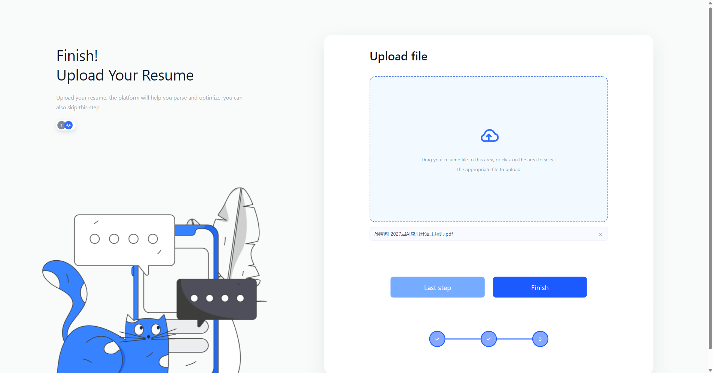

# Resume Upload Page

Implementation of the "Finish! Upload Your Resume" screen from the Figma link in the test.

Stack: React 18 + Vite. Styling is plain CSS; no UI library, because the target is a single screen and the spacing/type in the design is specific enough that overriding a component library would take longer than writing it directly.



## Run

```bash
npm install
npm run dev
```

Vite prints a local URL (usually `http://127.0.0.1:5173/`).

Production build:

```bash
npm run build
npm run preview
```

## What is implemented

- Two-column layout matching the 1920 × 1080 frame: left title/illustration, right upload card with 24 px radius and soft shadow.
- Upload area: click, keyboard (Enter/Space) and drag-and-drop all open the file picker/accept a drop. Only PDF/DOC/DOCX are accepted; unsupported files show a message.
- Selected file name is displayed in a list under the drop zone, with a remove button.
- The `1条` count badge appears when at least one file is selected, matching the state shown in the design.
- Buttons have hover, active and focus states. `Finish` without a file opens the picker; with a file it shows a success message and turns the last step into a check.
- `Last step` clears the current selection.
- Responsive: at ≤1050 px the two columns become one column (text → illustration → upload card), the card padding shrinks, and the buttons become full width.
- HTML uses `<main>`, `<section>`, `<h1>/<h2>`, `<ul>/<li>`, `<button>` and an accessible `role="button"` upload zone with `aria-label`.

## Notes

- The cat illustration was exported from the design and is kept as `src/assets/resume-illustration.png`.
- Colors used: page `#f8fbf9`, primary button `#1b5aff`, secondary `#75acff`, drop zone `#f2faff` with `#4b7be5` dashed border, body text `#101828`, muted `#a3a9b5`.
- No backend call is made; this is a front-end implementation of the screen.
